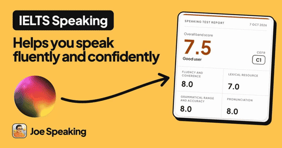

# OG Video Preview


An agent skill that turns any approved Open Graph image into a looping `og:video`, so your link previews move, and makes sure the video actually plays in iMessage, Safari and social cards.

> Works with [Claude Code](https://claude.com/claude-code), [OpenAI Codex](https://openai.com/index/codex/), [Cursor](https://cursor.sh) and other agents that support the [Agent Skills](https://agentskills.io) standard.

## Watch it

[18-second promo (MP4)](social/promo.mp4): it opens on the X post that started this (its own og:video playing), then deals out 20 of the eval's real sites and slams into all 61 at once. Made with Remotion; music "Deep Urban" from Mixkit (free licence); sound effects from [earshot](https://github.com/Leonxlnx/earshot).

## Tested on 61 real OG images


The OG images of 61 well-known sites, each turned into an og:video by the skill alone, with no hand tuning. Every card is scored: frame 0 must equal the image, the loop must close without a jump, and the files must stay under the size limits. The table, the videos and `python3 eval/run.py` to run it again are in [eval/](eval/). It doubles as the skill's regression test: re-run it after any change to the engine and compare.

## Examples

**JoeSpeaking.com homepage card**, from the finished image alone: the pill pops, the headline rises letter by letter, the report card settles in place, the orb and its arrow rise, the wordmark unfurls from its logo.



**Living style.** Nothing leaves: the blobs flow and settle, the title stays readable the whole time.


**demo.joespeaking.com talk card**, built as an HTML card (route B).


Rebuild them with `bash examples/build-examples.sh`; `out/layers-preview.png` in each folder shows what the skill recognised.

## How it works

1. **Approve the still.** Get the 1200×630 `og:image` right first.
2. **Turn that exact image into motion.** The skill reads the approved image and works out what each element is: headline, body text, label, logo, pill, icon, avatar, photo, panel, illustration, shape or line. It cuts each one out cleanly over a refilled background, and each kind gets its own physical motion. Type rises word by word out of its own line, marks spin in, pills pop, photos open, panels lift and lines draw, all on one set of easing curves and springs. Frame 0 and the last frame are the approved image, pixel for pixel.
3. **Publish both**, with tags and a server that let link previews play the video.

Two routes:

| Route | Start from | Good for |
|---|---|---|
| A. From the approved image | any PNG/JPG, made anywhere | existing cards, cards from Figma or Canva |
| B. From an HTML card | `template/og.html` | new cards designed in code |

## Where it plays

| Plays the video | Shows the still |
|---|---|
| **iMessage**: autoplays, muted, looping<br>**Discord**: inline player with a play button<br>**Telegram**: reports disagree, test on your device | Slack, X, Facebook, LinkedIn, WhatsApp, Signal, Bluesky, Mastodon, Matrix |

**Where video is not supported, nothing breaks: the app shows your `og:image`, the same approved image as frame 0 of the video.** So the preview is never worse than today, and it moves wherever it can. Details, conditions and sources are in [SKILL.md](SKILL.md#where-ogvideo-plays-checked-2026-10-30).

## The part that silently breaks playback

Apple's players request `Range: bytes=0-1` first and only play when the server answers **206 Partial Content**. Cloudflare Workers static assets answer 200 with the whole file, so the preview falls back to the still image. The skill checks for this (`scripts/check_live.sh`) and ships a small Worker that fixes it (`worker/range-worker.js`). It also versions files by name (`home-v3.mp4`) instead of query strings.

## Installation

### Claude Code plugin

```bash
/plugin marketplace add hubeiqiao/og-video-preview
/plugin install og-video-preview@og-video-preview-marketplace
```

### Agent Skills

```bash
npx skills add hubeiqiao/og-video-preview
```

### Manual

```bash
git clone https://github.com/hubeiqiao/og-video-preview.git ~/.claude/skills/og-video-preview
```

Requirements: Python 3 with `playwright` and `Pillow`, Google Chrome, `ffmpeg`.

## Usage

```
Use /og-video-preview to make my og:image move
```
```
Turn public/og/home.jpg into an OG video and wire up the tags
```
```
My og:video only shows a still in iMessage. Find out why.
```

The skill will:
1. Confirm the still is approved (or help design it, with rules for cards strangers can read at thumbnail size)
2. Propose layers and motion roles for the image
3. Render a few preview frames for review, then the full 60 fps loop
4. Check that frame 0 matches the approved image and that the loop has no visible jump
5. Encode the MP4 and JPEG, write the meta tags, and check the live server answers Range requests

## What's inside

```
og-video-preview/
├── SKILL.md                 # workflow, card and motion rules, tags, server requirements
├── template/
│   ├── from-image.html      # route A: the motion engine, motion chosen per element kind
│   └── og.html              # route B: configurable HTML card
├── scripts/
│   ├── suggest_layers.py    # read an image: find and classify every element
│   ├── make_plate.py        # clean plate and per-element cutouts
│   ├── render_frames.py     # Playwright frame capture at 2x
│   ├── check_frame0.py      # frame 0 vs the approved still
│   ├── check_loop.py        # seamless loop check
│   ├── encode.sh            # MP4 + JPEG, compressing harder until they fit the limits
│   └── check_live.sh        # live tags, files and Range check
├── worker/range-worker.js   # Range / 206 support on Cloudflare Workers assets
├── examples/                # worked examples: route A, living style, route B
├── eval/                    # 61 real OG images, the runner that scores them, the results
└── social/                  # this repo's own hero, social preview and promo
```

## Credits

Inspired by [Michael Pfister](https://x.com/pfista)'s [post on X](https://x.com/pfista/status/2113288415546638515): "this is your sign to start using og:video on your website".

Built by [Joe Hu](https://x.com/hubeiqiao) while making the link previews for [Joe Speaking](https://joespeaking.com) and a talk at A TON of Demos Ottawa.

## License

MIT
