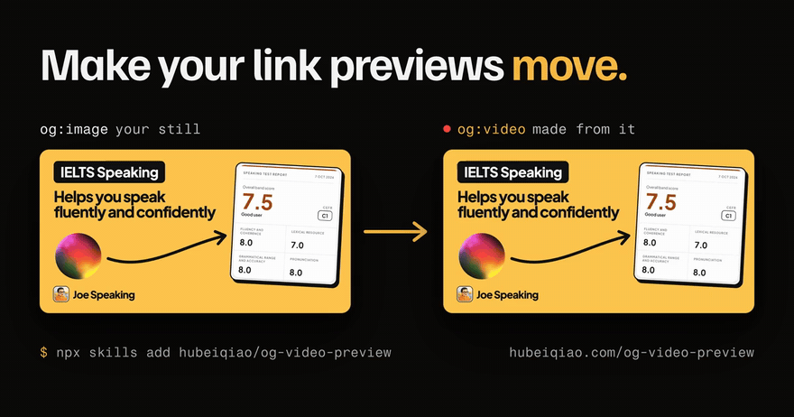
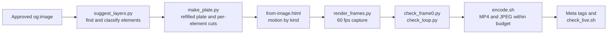
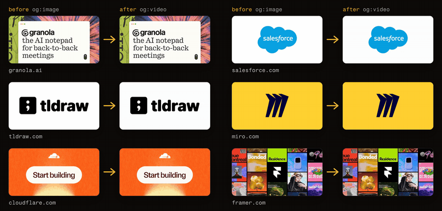
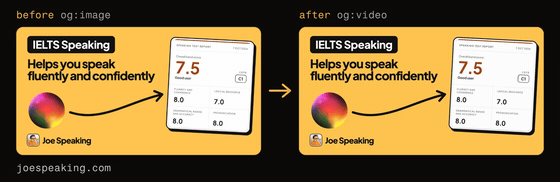
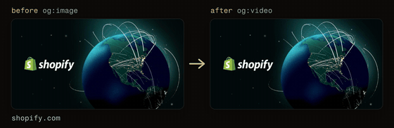
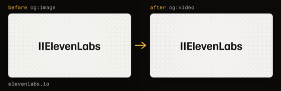
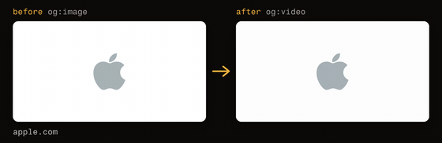
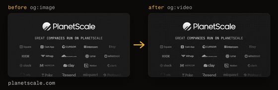
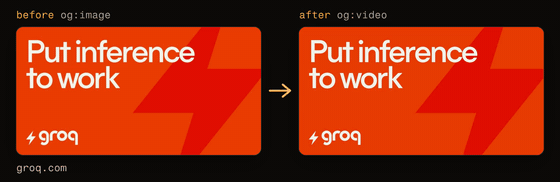
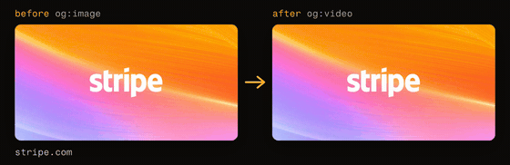

<div align="center">

# OG Video Preview

**Turn any approved `og:image` into a looping `og:video`, so your link previews move.**

An open-source agent skill for Claude Code, OpenAI Codex, Cursor and every agent that supports [Agent Skills](https://agentskills.io).

[](LICENSE)
[](eval/)
[](https://agentskills.io)

[Website](https://hubeiqiao.com/og-video-preview/) · [20-second film](social/promo.mp4) · [Eval](eval/) · [Skill reference](SKILL.md)



</div>

## Overview

A link preview is the first thing people see of your page in a chat. In iMessage, Discord and Telegram it can be a video, and almost nobody uses that. OG Video Preview takes the still image you already approved and turns it into a short, seamless loop:

- **It reads the image.** Every element is found and classified (headline, label, logo, pill, photo, stroke and six more kinds), cut out cleanly over a refilled background, and given motion that suits what it is.
- **Frame 0 is your image, pixel for pixel.** Apps that cannot play video show the same still they show today, so the preview is never worse than before.
- **It is checked, not hoped for.** Every render is tested for frame-0 identity, a seamless loop and file-size budgets, and the live server is tested for the HTTP Range support Apple's players require.

```bash
npx skills add hubeiqiao/og-video-preview
```

Then ask your agent: *"Use /og-video-preview to make my og:image move."*

## Contents

- [Features](#features)
- [Installation](#installation)
- [Usage](#usage)
- [How it works](#how-it-works)
- [Where og:video plays](#where-ogvideo-plays)
- [Evaluation](#evaluation)
- [Examples](#examples)
- [Serving requirements](#serving-requirements)
- [Repository layout](#repository-layout)
- [Credits and license](#credits-and-license)

## Features

| Feature | What it does |
|---|---|
| **Element-aware motion** | Twelve element kinds, each with its own entrance, exit, idle movement and accent, on one set of easing curves and damped springs. Accents differ from card to card (a sweep, hopping letters, a star, a coin flip, a swing), and a fine background texture moves as one surface |
| **Works from the finished image** | Any PNG or JPG, made in Figma, Canva or code (route A), or a configurable HTML card (route B) |
| **Clean cut-outs** | Each element owns its exact pixels; the background behind it is refilled, and visuals that cannot be refilled cleanly move in place instead of leaving |
| **Seamless 4 s loops at 60 fps** | Every idle, accent and camera move is exactly zero at the loop point |
| **Measured quality gates** | Frame-0 mean difference and local defects, seam size, MP4 and JPEG budgets, all scripted |
| **Deploys correctly** | Meta tags, versioned filenames, a Range check for the live server, and a Cloudflare Worker that adds `206 Partial Content` |

## Installation

**Agent Skills** (any compatible agent):

```bash
npx skills add hubeiqiao/og-video-preview
```

**Claude Code plugin:**

```bash
/plugin marketplace add hubeiqiao/og-video-preview
/plugin install og-video-preview@og-video-preview-marketplace
```

**Manual:**

```bash
git clone https://github.com/hubeiqiao/og-video-preview.git ~/.claude/skills/og-video-preview
```

**Requirements:** Python 3 with `playwright`, `Pillow`, `opencv-python` and `numpy`; Google Chrome; `ffmpeg` and `ffprobe`. [Tesseract](https://github.com/tesseract-ocr/tesseract) is optional and improves text reading on photos.

## Usage

Ask in your own words:

```
Use /og-video-preview to make my og:image move
```
```
Turn public/og/home.jpg into an OG video and wire up the tags
```
```
My og:video only shows a still in iMessage. Find out why.
```

The skill then:

1. Confirms the still is approved, or helps design one that strangers can read at thumbnail size.
2. Reads the image and proposes the layers and their motion (`layers-preview.png` shows every box and its kind).
3. Renders preview frames for review, then the full 60 fps loop.
4. Checks that frame 0 matches the approved image and that the loop has no visible jump.
5. Encodes the MP4 and JPEG, writes the meta tags, and checks that the live server answers Range requests.

## How it works



| Kind | Recognised as | Motion |
|---|---|---|
| `headline` | lines with the largest cap height | words or letters rise out of the line's own mask on a spring |
| `text` | other lines of text | fade, short rise and a clearing blur |
| `label` | small text: kickers, URLs, captions | wipes on from the left |
| `logo` | a mark at the start of a line of text | scales up with a spin; a wordmark unfurls from it |
| `pill` | a solid bar with content: tags, buttons | pops with a slight overshoot |
| `icon` | a small graphic with inner detail | springs up with a small turn |
| `avatar` | a round element with photo detail | springs up with a turn, then floats |
| `photo` | a solid rectangle with many colours | opens from the middle while settling |
| `panel` | a large solid surface: screenshots, UI cards | lifts with a scale and a clearing blur |
| `illustration` | a larger multicolour graphic | rises with a squash on landing |
| `shape` | a one-colour form: dots, blobs, squares | small ones pop outward from the headline; large ones flow and settle |
| `stroke` | lines, arrows, underlines, squiggles | draws at an even pen pace; an arrow draws from its tail to its head |

Full detail, including styles (`rebuild`, `living`), energy levels and per-layer overrides, is in [SKILL.md](SKILL.md).

## Where og:video plays

| Plays the video | Shows the still |
|---|---|
| **iMessage**: autoplays, muted, looping<br>**Discord**: inline player with a play button<br>**Telegram**: plays it as a looping GIF | Slack, X, Facebook, LinkedIn, WhatsApp, Signal, Bluesky, Mastodon, Matrix |

**Where video is not supported, nothing breaks:** the app shows your `og:image`, which is the same approved image as frame 0 of the video. Conditions and sources, checked 2026-10-30, are in [SKILL.md](SKILL.md#where-ogvideo-plays-checked-2026-10-30).

## Evaluation



The skill is tested on the Open Graph images of 103 well-known sites, each put through the whole pipeline with no hand tuning and scored automatically. They cover developer tools and products (61), venture capital firms such as Y Combinator, a16z and Sequoia (16), AI companies such as OpenAI, Mistral and ElevenLabs (18), and technology companies such as Apple, IBM and Cloudflare (8).

| Check | Pass when |
|---|---|
| Frame 0 | mean difference to the image ≤ 2, and local defects on ≤ 0.05 % of pixels |
| Seam | the jump from the last frame to the first is at most 1.5 ordinary frame steps (plus 4 levels of slack) |
| Size | MP4 ≤ 2 MB, frame-0 JPEG ≤ 180 KB |

All 103 pass. Run it after any change to the engine:

```bash
python3 eval/fetch.py                            # download the og:image of every site in eval/sites.txt
python3 eval/run.py                              # all cards: videos, results.json, sheet.jpg
python3 eval/run.py --only stripe,github --keep  # a few cards, keeping their intermediate files
```

`results.json` records what the engine decided for every card, so a change can be compared card by card. The images in `eval/cards/` belong to their owners and are used only as test inputs; they are not covered by this repository's license.

## Examples

Each pair is the site's approved `og:image` on the left and the `og:video` the skill made from it on the right, with no hand tuning unless noted.

|  |  |
|---|---|
| **[This project's page](https://hubeiqiao.com/og-video-preview/)**: an illustration with a clean background (`--plate`), so every object moves | **[joespeaking.com](https://joespeaking.com)**: the flow style, with the arrow's cut corrected by hand |
|  |  |
| **shopify.com**: the globe turns | **elevenlabs.io**: the line texture moves as one surface |
|  |  |
| **apple.com**: a lone mark, revealed like a product | **planetscale.com**: a logo wall, a pop and a band of light |
|  |  |
| **groq.com**: a flat graphic behind the type moves | **stripe.com**: the headline rises out of its own line |

The six site cards are from the [eval](eval/); their images belong to their owners and are used only as test inputs. More worked examples, with their inputs (a living-style card and a card built in HTML), are in [`examples/`](examples/). Regenerate these GIFs with `python3 tools/readme_gifs.py`.

Rebuild them with `bash examples/build-examples.sh`. The [website](https://hubeiqiao.com/og-video-preview/)'s own link preview is made by the skill itself from its approved still, with a clean background (`--plate`) so every object can move (`site/og/build.sh`).

## Serving requirements

Apple's players request `Range: bytes=0-1` first and play only when the server answers **`206 Partial Content`**. Static assets on Cloudflare Workers answer `200` with the whole file, so the preview silently falls back to the still. The skill checks for this with `scripts/check_live.sh` and ships `worker/range-worker.js` to fix it. Files are versioned by name (`home-v3.mp4`), never by query string.

## Repository layout

```
og-video-preview/
├── SKILL.md                 workflow, element kinds, motion, tags, server requirements
├── template/
│   ├── from-image.html      route A: the motion engine
│   └── og.html              route B: a configurable HTML card
├── scripts/
│   ├── suggest_layers.py    find and classify every element
│   ├── make_plate.py        refilled plate, per-element cuts, light and glyph masks
│   ├── render_frames.py     frame capture with Playwright
│   ├── check_frame0.py      frame 0 against the approved image
│   ├── check_loop.py        seam check
│   ├── encode.sh            MP4 and JPEG within the size budgets
│   └── check_live.sh        live tags, files and Range support
├── worker/range-worker.js   206 Partial Content on Cloudflare Workers
├── eval/                    103 real OG images, the fetcher, the runner and the results
├── examples/                worked examples for both routes
├── site/                    the website; its own og:video is made with the skill
└── social/                  the film and the social preview
```

## Credits and license

- Inspired by [Michael Pfister](https://x.com/pfista)'s [post on X](https://x.com/pfista/status/2113288415546638515): "this is your sign to start using og:video on your website".
- Built by [Joe Hu](https://x.com/hubeiqiao) while making the link previews for [Joe Speaking](https://joespeaking.com).
- The film uses music ("Digital Clouds" by Alejandro Magaña) and sound effects from [Mixkit](https://mixkit.co) under the Mixkit free license. The website uses the Watch texture from [Textures](https://textures.dev) (MIT).

Released under the [MIT License](LICENSE).
