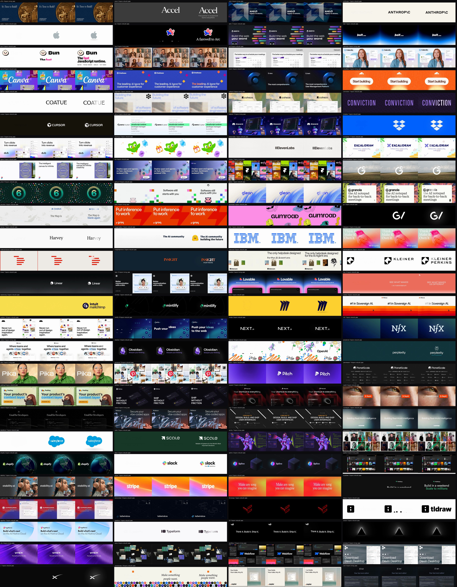

# Eval: 103 real OG images

The skill should work on any approved OG image, not only on cards made for it. This folder is its test: the Open Graph images of 103 well-known sites (developer tools and products, venture capital firms, AI companies and technology companies), each put through the whole route A pipeline with no hand tuning, and scored.



```bash
python3 eval/fetch.py            # download the og:image of every site in sites.txt that is not in cards/ yet
python3 eval/run.py              # all cards, 3 at a time: out/*.mp4, results.json, sheet.jpg, the table below
python3 eval/run.py --only stripe,github --keep   # a few cards, keeping their layers.js, plate and cuts in eval/work/
```

What is measured on every card:

| Check | Pass when |
|---|---|
| Frame 0 | it equals the card: mean difference ≤ 2, and local defects (a gap between letters, a missing edge) on ≤ 0.05 % of pixels |
| Seam | the jump from the last frame to the first is at most 1.5 ordinary frame steps (plus 4 levels of slack) |
| Motion | some frame differs from frame 0 by a mean of 0.2 levels or more (a frozen video is seamless too) |
| Size | MP4 ≤ 2 MB, frame-0 JPEG ≤ 180 KB |

`results.json` also records what the engine decided for each card (how many layers, which kinds, rebuild or living), so a change to the engine can be compared card by card. Re-run after any change to `scripts/` or `template/from-image.html` and read the diff of `results.json` and `sheet.jpg`.

The images in `cards/` were fetched from each site's `og:image` by `fetch.py` (`sites.txt` lists the pages, in groups with the date each group was fetched: 2026-10-29 and 2026-10-30) and cover-cropped to 1200×630. Sites with no og:image, a square logo instead of a link card, or a server that refuses the request are skipped. They belong to their owners and are here only as test inputs; they are not covered by this repository's MIT licence.

<!-- results -->
**104 of 104 cards pass.**

| Card | Layers | Kinds | Style | Frame 0 (mean / local) | Seam / step | MP4 | Pass |
|---|---|---|---|---|---|---|---|
| [a16z](out/a16z.mp4) | 4 | text 3, headline 1 | living | 0.525 / 0.0% | 0 / 2 | 1250 KB | yes |
| [accel](out/accel.mp4) | 3 | text 2, headline 1 | rebuild | 0.163 / 0.0% | 1 / 3 | 414 KB | yes |
| [amd](out/amd.mp4) | 4 | label 2, text 2 | living | 0.413 / 0.0% | 0 / 2 | 1031 KB | yes |
| [anthropic](out/anthropic.mp4) | 1 | headline 1 | rebuild | 0.07 / 0.0% | 1 / 3 | 95 KB | yes |
| [apple](out/apple.mp4) | 1 | shape 1 | rebuild | 0.007 / 0.0% | 0 / 1 | 41 KB | yes |
| [arc](out/arc.mp4) | 2 | illustration 1, headline 1 | rebuild | 0.131 / 0.0% | 53 / 52 | 172 KB | yes |
| [astro](out/astro.mp4) | 12 | illustration 8, headline 2, text 1, pill 1 | rebuild | 0.397 / 0.0% | 0 / 2 | 694 KB | yes |
| [bolt](out/bolt.mp4) | 1 | headline 1 | rebuild | 0.17 / 0.0% | 0 / 1 | 289 KB | yes |
| [bun](out/bun.mp4) | 5 | headline 3, logo 1, label 1 | rebuild | 0.325 / 0.0% | 0 / 0 | 178 KB | yes |
| [bvp](out/bvp.mp4) | 0 |  | living | 0.432 / 0.0% | 0 / 1 | 1128 KB | yes |
| [cal](out/cal.mp4) | 9 | shape 4, label 2, text 1, headline 1, illustration 1 | rebuild | 0.272 / 0.0% | 1 / 1 | 106 KB | yes |
| [calendly](out/calendly.mp4) | 6 | label 2, logo 1, headline 1, icon 1, illustration 1 | living | 0.28 / 0.0% | 0 / 2 | 760 KB | yes |
| [canva](out/canva.mp4) | 8 | illustration 4, text 3, stroke 1 | rebuild | 0.273 / 0.0% | 0 / 2 | 704 KB | yes |
| [chatbase](out/chatbase.mp4) | 6 | shape 3, headline 2, text 1 | rebuild | 0.39 / 0.0% | 1 / 3 | 815 KB | yes |
| [clerk](out/clerk.mp4) | 4 | headline 2, logo 1, stroke 1 | rebuild | 0.238 / 0.0% | 0 / 1 | 385 KB | yes |
| [cloudflare](out/cloudflare.mp4) | 3 | headline 2, shape 1 | living | 0.359 / 0.0% | 0 / 2 | 1074 KB | yes |
| [coatue](out/coatue.mp4) | 1 | headline 1 | rebuild | 0.088 / 0.0% | 1 / 2 | 106 KB | yes |
| [cognition](out/cognition.mp4) | 5 | illustration 3, panel 1, headline 1 | rebuild | 0.273 / 0.0% | 2 / 4 | 544 KB | yes |
| [cohere](out/cohere.mp4) | 6 | label 4, headline 2 | living | 0.403 / 0.0% | 0 / 2 | 1758 KB | yes |
| [conviction](out/conviction.mp4) | 1 | headline 1 | rebuild | 0.195 / 0.0% | 1 / 3 | 422 KB | yes |
| [cursor](out/cursor.mp4) | 2 | logo 1, headline 1 | rebuild | 0.064 / 0.0% | 38 / 38 | 71 KB | yes |
| [deno](out/deno.mp4) | 5 | text 4, headline 1 | rebuild | 0.191 / 0.0% | 2 / 5 | 412 KB | yes |
| [discord](out/discord.mp4) | 17 | icon 11, stroke 2, headline 1, shape 1, logo 1, illustration 1 | living | 0.273 / 0.0% | 0 / 2 | 823 KB | yes |
| [dropbox](out/dropbox.mp4) | 1 | logo 1 | rebuild | 0.039 / 0.0% | 1 / 1 | 196 KB | yes |
| [dub](out/dub.mp4) | 11 | icon 3, text 2, stroke 2, label 2, headline 1, shape 1 | living | 0.325 / 0.0% | 2 / 4 | 706 KB | yes |
| [duolingo](out/duolingo.mp4) | 3 | shape 2, illustration 1 | rebuild | 0.091 / 0.0% | 1 / 3 | 221 KB | yes |
| [elevenlabs](out/elevenlabs.mp4) | 1 | headline 1 | rebuild | 0.21 / 0.0% | 1 / 3 | 455 KB | yes |
| [excalidraw](out/excalidraw.mp4) | 11 | icon 5, shape 2, logo 1, headline 1, text 1, label 1 | rebuild | 0.174 / 0.0% | 0 / 1 | 254 KB | yes |
| [figma](out/figma.mp4) | 5 | headline 3, illustration 1, icon 1 | rebuild | 0.297 / 0.0% | 1 / 2 | 180 KB | yes |
| [fly](out/fly.mp4) | 9 | icon 4, headline 3, avatar 1, text 1 | rebuild | 0.372 / 0.0% | 0 / 3 | 694 KB | yes |
| [framer](out/framer.mp4) | 7 | headline 6, label 1 | living | 0.498 / 0.0% | 0 / 2 | 1051 KB | yes |
| [generalcatalyst](out/generalcatalyst.mp4) | 0 |  | living | 0.233 / 0.0% | 0 / 1 | 583 KB | yes |
| [ghost](out/ghost.mp4) | 18 | icon 13, illustration 2, logo 2, avatar 1 | rebuild | 0.241 / 0.0% | 0 / 2 | 256 KB | yes |
| [github](out/github.mp4) | 10 | shape 4, illustration 3, headline 2, icon 1 | rebuild | 0.236 / 0.0% | 1 / 2 | 274 KB | yes |
| [glean](out/glean.mp4) | 7 | stroke 1, headline 1, shape 1, illustration 1, label 1, text 1, icon 1 | rebuild | 0.152 / 0.0% | 0 / 1 | 364 KB | yes |
| [granola](out/granola.mp4) | 8 | icon 4, headline 4 | rebuild | 0.504 / 0.0% | 0 / 2 | 756 KB | yes |
| [greylock](out/greylock.mp4) | 4 | headline 3, shape 1 | rebuild | 0.184 / 0.0% | 0 / 2 | 267 KB | yes |
| [groq](out/groq.mp4) | 4 | headline 4 | living | 0.134 / 0.0% | 0 / 2 | 246 KB | yes |
| [gumroad](out/gumroad.mp4) | 6 | illustration 5, headline 1 | rebuild | 0.413 / 0.0% | 0 / 2 | 634 KB | yes |
| [gv](out/gv.mp4) | 1 | shape 1 | rebuild | 0.049 / 0.0% | 58 / 61 | 207 KB | yes |
| [harvey](out/harvey.mp4) | 1 | headline 1 | rebuild | 0.053 / 0.0% | 1 / 3 | 72 KB | yes |
| [huggingface](out/huggingface.mp4) | 3 | headline 2, illustration 1 | rebuild | 0.165 / 0.0% | 1 / 3 | 337 KB | yes |
| [ibm](out/ibm.mp4) | 1 | illustration 1 | rebuild | 0.165 / 0.0% | 1 / 3 | 163 KB | yes |
| [ideogram](out/ideogram.mp4) | 2 | headline 2 | living | 0.391 / 0.0% | 0 / 2 | 1262 KB | yes |
| [indexventures](out/indexventures.mp4) | 6 | pill 5, illustration 1 | rebuild | 0.064 / 0.0% | 3 / 5 | 46 KB | yes |
| [insightpartners](out/insightpartners.mp4) | 2 | headline 1, text 1 | rebuild | 0.045 / 0.0% | 0 / 1 | 157 KB | yes |
| [intercom](out/intercom.mp4) | 8 | headline 2, icon 2, panel 1, illustration 1, photo 1, text 1 | rebuild | 0.416 / 0.0% | 1 / 2 | 355 KB | yes |
| [kleinerperkins](out/kleinerperkins.mp4) | 3 | headline 2, panel 1 | rebuild | 0.145 / 0.0% | 1 / 4 | 141 KB | yes |
| [linear](out/linear.mp4) | 1 | headline 1 | rebuild | 0.078 / 0.0% | 0 / 2 | 216 KB | yes |
| [loom](out/loom.mp4) | 10 | icon 4, headline 3, illustration 1, shape 1, label 1 | living | 0.263 / 0.0% | 1 / 2 | 495 KB | yes |
| [lovable](out/lovable.mp4) | 5 | text 4, headline 1 | living | 0.315 / 0.0% | 0 / 2 | 734 KB | yes |
| [lsvp](out/lsvp.mp4) | 10 | stroke 7, headline 2, icon 1 | rebuild | 0.07 / 0.0% | 0 / 1 | 87 KB | yes |
| [mailchimp](out/mailchimp.mp4) | 3 | headline 2, logo 1 | rebuild | 0.133 / 0.0% | 2 / 4 | 211 KB | yes |
| [mintlify](out/mintlify.mp4) | 1 | headline 1 | rebuild | 0.077 / 0.0% | 1 / 3 | 211 KB | yes |
| [miro](out/miro.mp4) | 1 | shape 1 | rebuild | 0.048 / 0.0% | 0 / 2 | 127 KB | yes |
| [mistral](out/mistral.mp4) | 4 | logo 1, headline 1, illustration 1, stroke 1 | rebuild | 0.166 / 0.0% | 0 / 2 | 339 KB | yes |
| [mobbin](out/mobbin.mp4) | 16 | icon 6, headline 4, illustration 2, shape 1, pill 1, avatar 1, label 1 | rebuild | 0.316 / 0.0% | 0 / 1 | 224 KB | yes |
| [netlify](out/netlify.mp4) | 16 | icon 6, avatar 5, headline 3, text 1, shape 1 | rebuild | 0.272 / 0.0% | 0 / 3 | 598 KB | yes |
| [nextjs](out/nextjs.mp4) | 2 | headline 1, text 1 | rebuild | 0.049 / 0.0% | 1 / 2 | 113 KB | yes |
| [nfx](out/nfx.mp4) | 1 | shape 1 | rebuild | 0.084 / 0.0% | 64 / 63 | 426 KB | yes |
| [notion](out/notion.mp4) | 6 | headline 2, logo 1, illustration 1, stroke 1, text 1 | living | 0.376 / 0.0% | 1 / 3 | 720 KB | yes |
| [obsidian](out/obsidian.mp4) | 3 | illustration 1, headline 1, text 1 | rebuild | 0.157 / 0.0% | 1 / 3 | 334 KB | yes |
| [openai](out/openai.mp4) | 15 | icon 7, shape 3, headline 2, illustration 1, logo 1, text 1 | rebuild | 0.453 / 0.0% | 1 / 2 | 774 KB | yes |
| [perplexity](out/perplexity.mp4) | 3 | icon 1, headline 1, text 1 | rebuild | 0.119 / 0.0% | 1 / 2 | 290 KB | yes |
| [pika](out/pika.mp4) | 2 | headline 1, text 1 | living | 0.256 / 0.0% | 0 / 1 | 646 KB | yes |
| [pinterest](out/pinterest.mp4) | 10 | illustration 9, icon 1 | rebuild | 0.432 / 0.0% | 0 / 2 | 1151 KB | yes |
| [pitch](out/pitch.mp4) | 1 | headline 1 | rebuild | 0.07 / 0.0% | 0 / 2 | 289 KB | yes |
| [planetscale](out/planetscale.mp4) | 14 | logo 5, text 3, label 2, shape 2, headline 1, icon 1 | rebuild | 0.374 / 0.0% | 1 / 2 | 915 KB | yes |
| [posthog](out/posthog.mp4) | 8 | icon 3, stroke 1, logo 1, headline 1, illustration 1, pill 1 | rebuild | 0.32 / 0.0% | 0 / 2 | 531 KB | yes |
| [railway](out/railway.mp4) | 12 | icon 4, headline 3, illustration 2, text 1, label 1, logo 1 | rebuild | 0.241 / 0.0% | 2 / 5 | 589 KB | yes |
| [raycast](out/raycast.mp4) | 17 | icon 8, label 5, logo 1, text 1, headline 1, illustration 1 | rebuild | 0.284 / 0.0% | 2 / 4 | 699 KB | yes |
| [replit](out/replit.mp4) | 6 | illustration 2, icon 2, shape 1, headline 1 | rebuild | 0.235 / 0.0% | 0 / 1 | 500 KB | yes |
| [resend](out/resend.mp4) | 4 | headline 1, label 1, illustration 1, shape 1 | living | 0.2 / 0.0% | 2 / 3 | 727 KB | yes |
| [retool](out/retool.mp4) | 5 | text 2, headline 2, label 1 | living | 0.38 / 0.0% | 0 / 2 | 694 KB | yes |
| [rive](out/rive.mp4) | 11 | stroke 4, text 2, headline 2, logo 1, icon 1, illustration 1 | rebuild | 0.325 / 0.0% | 1 / 2 | 335 KB | yes |
| [runwayml](out/runwayml.mp4) | 1 | headline 1 | rebuild | 0.148 / 0.0% | 0 / 2 | 333 KB | yes |
| [salesforce](out/salesforce.mp4) | 2 | headline 1, shape 1 | rebuild | 0.047 / 0.0% | 0 / 2 | 104 KB | yes |
| [scale](out/scale.mp4) | 3 | text 2, headline 1 | rebuild | 0.178 / 0.0% | 1 / 3 | 486 KB | yes |
| [sentry](out/sentry.mp4) | 1 | logo 1 | living | 0.261 / 0.0% | 1 / 2 | 627 KB | yes |
| [sequoiacap](out/sequoiacap.mp4) | 3 | illustration 1, panel 1, headline 1 | living | 0.643 / 0.0% | 1 / 2 | 1732 KB | yes |
| [shopify](out/shopify.mp4) | 5 | icon 4, headline 1 | rebuild | 0.275 / 0.0% | 2 / 13 | 666 KB | yes |
| [slack](out/slack.mp4) | 3 | logo 1, headline 1, text 1 | rebuild | 0.084 / 0.0% | 1 / 2 | 124 KB | yes |
| [spline](out/spline.mp4) | 3 | illustration 1, label 1, stroke 1 | rebuild | 0.07 / 0.0% | 1 / 2 | 209 KB | yes |
| [spotify](out/spotify.mp4) | 5 | illustration 2, shape 2, stroke 1 | living | 0.398 / 0.0% | 1 / 2 | 1087 KB | yes |
| [stability](out/stability.mp4) | 1 | headline 1 | living | 0.414 / 0.0% | 0 / 2 | 1020 KB | yes |
| [stripe](out/stripe.mp4) | 1 | headline 1 | rebuild | 0.24 / 0.0% | 0 / 1 | 643 KB | yes |
| [suno](out/suno.mp4) | 2 | headline 2 | rebuild | 0.402 / 0.0% | 0 / 1 | 963 KB | yes |
| [supabase](out/supabase.mp4) | 3 | headline 2, logo 1 | rebuild | 0.142 / 0.0% | 1 / 3 | 345 KB | yes |
| [superhuman](out/superhuman.mp4) | 7 | icon 2, label 2, illustration 1, avatar 1, text 1 | rebuild | 0.378 / 0.0% | 0 / 1 | 929 KB | yes |
| [tailwindcss](out/tailwindcss.mp4) | 14 | logo 3, label 2, stroke 2, headline 2, icon 2, illustration 2, shape 1 | rebuild | 0.27 / 0.0% | 1 / 2 | 733 KB | yes |
| [thrivecap](out/thrivecap.mp4) | 1 | stroke 1 | rebuild | 0.026 / 0.0% | 1 / 1 | 42 KB | yes |
| [tldraw](out/tldraw.mp4) | 2 | panel 1, headline 1 | rebuild | 0.109 / 0.0% | 1 / 5 | 122 KB | yes |
| [together](out/together.mp4) | 3 | headline 2, illustration 1 | rebuild | 0.151 / 0.0% | 2 / 3 | 344 KB | yes |
| [typeform](out/typeform.mp4) | 1 | headline 1 | rebuild | 0.052 / 0.0% | 1 / 3 | 81 KB | yes |
| [v0](out/v0.mp4) | 2 | headline 2 | rebuild | 0.116 / 0.0% | 2 / 4 | 223 KB | yes |
| [vercel](out/vercel.mp4) | 1 | illustration 1 | rebuild | 0.046 / 0.0% | 1 / 1 | 143 KB | yes |
| [vite](out/vite.mp4) | 4 | headline 2, illustration 1, label 1 | living | 0.526 / 0.0% | 0 / 2 | 1197 KB | yes |
| [warp](out/warp.mp4) | 4 | illustration 1, shape 1, icon 1, panel 1 | rebuild | 0.22 / 0.0% | 1 / 3 | 439 KB | yes |
| [webflow](out/webflow.mp4) | 13 | illustration 4, label 3, stroke 3, icon 1, logo 1, headline 1 | living | 0.354 / 0.0% | 1 / 2 | 1234 KB | yes |
| [windsurf](out/windsurf.mp4) | 5 | headline 5 | living | 0.478 / 0.0% | 0 / 2 | 1598 KB | yes |
| [x](out/x.mp4) | 1 | shape 1 | rebuild | 0.027 / 0.0% | 52 / 53 | 163 KB | yes |
| [ycombinator](out/ycombinator.mp4) | 18 | avatar 15, headline 2, illustration 1 | rebuild | 0.354 / 0.0% | 0 / 2 | 185 KB | yes |
| [zapier](out/zapier.mp4) | 8 | headline 5, label 2, text 1 | living | 0.322 / 0.0% | 0 / 3 | 340 KB | yes |
| [zed](out/zed.mp4) | 3 | illustration 2, logo 1 | living | 0.379 / 0.0% | 0 / 2 | 1315 KB | yes |
<!-- /results -->

## With the reading step

The table above is the skill with no help: it reads every card on its own. The skill's workflow starts with a reading step, where the agent looks at the card, says what it shows and writes a short plan (`eval/scenes/<name>.json`): which parts are whole units and what each one is, for example a window, a button, a scribble, a list, a ring of avatars or a row of logos. Cards whose automatic reading missed what they show are run again with their plan, as `out/<name>-read.mp4`:

<!-- read -->
**51 of 51 cards pass.**

| Card | Layers | Kinds | Style | Frame 0 (mean / local) | Seam / step | MP4 | Pass |
|---|---|---|---|---|---|---|---|
| [a16z-read](out/a16z-read.mp4) | 4 | text 2, headline 1, photo 1 | living | 0.53 / 0.0% | 1 / 3 | 1140 KB | yes |
| [amd-read](out/amd-read.mp4) | 3 | text 2, headline 1 | living | 0.413 / 0.0% | 0 / 2 | 1162 KB | yes |
| [bolt-read](out/bolt-read.mp4) | 1 | headline 1 | rebuild | 0.17 / 0.0% | 0 / 1 | 288 KB | yes |
| [cal-read](out/cal-read.mp4) | 9 | shape 4, text 1, headline 1, illustration 1, label 1, pill 1 | rebuild | 0.271 / 0.0% | 1 / 1 | 119 KB | yes |
| [calendly-read](out/calendly-read.mp4) | 5 | panel 2, logo 1, headline 1, pill 1 | living | 0.281 / 0.0% | 1 / 2 | 693 KB | yes |
| [canva-read](out/canva-read.mp4) | 4 | illustration 4 | rebuild | 0.275 / 0.0% | 96 / 97 | 664 KB | yes |
| [chatbase-read](out/chatbase-read.mp4) | 3 | headline 2, text 1 | rebuild | 0.39 / 0.0% | 1 / 3 | 853 KB | yes |
| [cloudflare-read](out/cloudflare-read.mp4) | 2 | logo 1, pill 1 | living | 0.358 / 0.0% | 0 / 1 | 993 KB | yes |
| [cohere-read](out/cohere-read.mp4) | 5 | label 3, logo 1, pill 1 | living | 0.399 / 0.0% | 0 / 2 | 1621 KB | yes |
| [deno-read](out/deno-read.mp4) | 11 | text 11 | rebuild | 0.478 / 0.011% | 0 / 0 | 333 KB | yes |
| [discord-read](out/discord-read.mp4) | 6 | illustration 5, logo 1 | living | 0.273 / 0.0% | 152 / 168 | 574 KB | yes |
| [excalidraw-read](out/excalidraw-read.mp4) | 2 | stroke 2 | rebuild | 0.168 / 0.0% | 1 / 3 | 379 KB | yes |
| [fly-read](out/fly-read.mp4) | 10 | icon 4, headline 3, avatar 1, text 1, pill 1 | rebuild | 0.373 / 0.0% | 0 / 3 | 707 KB | yes |
| [framer-read](out/framer-read.mp4) | 4 | illustration 4 | living | 0.497 / 0.0% | 80 / 80 | 857 KB | yes |
| [ghost-read](out/ghost-read.mp4) | 0 |  | rebuild | 0.236 / 0.0% | 240 / 243 | 736 KB | yes |
| [glean-read](out/glean-read.mp4) | 1 | headline 1 | rebuild | 0.149 / 0.0% | 0 / 1 | 486 KB | yes |
| [granola-read](out/granola-read.mp4) | 8 | headline 4, icon 3, pill 1 | rebuild | 0.504 / 0.0% | 0 / 2 | 771 KB | yes |
| [groq-read](out/groq-read.mp4) | 4 | headline 3, logo 1 | living | 0.133 / 0.0% | 0 / 2 | 379 KB | yes |
| [ibm-read](out/ibm-read.mp4) | 1 | stroke 1 | rebuild | 0.164 / 0.0% | 1 / 3 | 146 KB | yes |
| [loom-read](out/loom-read.mp4) | 11 | headline 3, icon 3, logo 1, illustration 1, pill 1, shape 1, label 1 | living | 0.263 / 0.0% | 1 / 2 | 482 KB | yes |
| [lovable-read](out/lovable-read.mp4) | 5 | logo 1, headline 1, text 1, illustration 1, pill 1 | living | 0.313 / 0.0% | 0 / 2 | 726 KB | yes |
| [mobbin-read](out/mobbin-read.mp4) | 5 | illustration 5 | rebuild | 0.316 / 0.0% | 145 / 140 | 343 KB | yes |
| [nextjs-read](out/nextjs-read.mp4) | 1 | headline 1 | rebuild | 0.049 / 0.0% | 0 / 2 | 135 KB | yes |
| [notion-read](out/notion-read.mp4) | 6 | logo 1, headline 1, pill 1, illustration 1, stroke 1, text 1 | living | 0.376 / 0.0% | 1 / 3 | 693 KB | yes |
| [obsidian-read](out/obsidian-read.mp4) | 3 | photo 1, headline 1, text 1 | rebuild | 0.157 / 0.0% | 1 / 3 | 331 KB | yes |
| [openai-read](out/openai-read.mp4) | 18 | illustration 5, icon 4, shape 3, stroke 3, headline 2, logo 1 | rebuild | 0.455 / 0.0% | 94 / 94 | 866 KB | yes |
| [pika-read](out/pika-read.mp4) | 2 | headline 1, text 1 | living | 0.256 / 0.0% | 0 / 1 | 647 KB | yes |
| [pinterest-read](out/pinterest-read.mp4) | 8 | illustration 7, logo 1 | rebuild | 0.425 / 0.0% | 227 / 228 | 894 KB | yes |
| [planetscale-read](out/planetscale-read.mp4) | 15 | logo 5, text 3, label 2, shape 2, photo 1, headline 1, icon 1 | rebuild | 0.374 / 0.0% | 1 / 2 | 951 KB | yes |
| [posthog-read](out/posthog-read.mp4) | 8 | icon 3, stroke 1, logo 1, headline 1, illustration 1, pill 1 | rebuild | 0.322 / 0.0% | 1 / 2 | 535 KB | yes |
| [railway-read](out/railway-read.mp4) | 12 | icon 4, headline 3, illustration 2, text 1, label 1, logo 1 | rebuild | 0.241 / 0.0% | 2 / 5 | 598 KB | yes |
| [raycast-read](out/raycast-read.mp4) | 17 | icon 7, label 5, illustration 2, logo 1, text 1, headline 1 | rebuild | 0.284 / 0.0% | 2 / 4 | 700 KB | yes |
| [replit-read](out/replit-read.mp4) | 6 | icon 2, illustration 1, pill 1, shape 1, headline 1 | rebuild | 0.236 / 0.0% | 0 / 1 | 515 KB | yes |
| [resend-read](out/resend-read.mp4) | 5 | illustration 2, headline 1, label 1, shape 1 | living | 0.2 / 0.0% | 4 / 4 | 723 KB | yes |
| [retool-read](out/retool-read.mp4) | 5 | text 2, headline 2, label 1 | living | 0.38 / 0.0% | 0 / 2 | 717 KB | yes |
| [runwayml-read](out/runwayml-read.mp4) | 2 | headline 1, logo 1 | rebuild | 0.148 / 0.0% | 23 / 24 | 423 KB | yes |
| [sentry-read](out/sentry-read.mp4) | 1 | logo 1 | living | 0.261 / 0.0% | 1 / 2 | 642 KB | yes |
| [spotify-read](out/spotify-read.mp4) | 6 | illustration 2, shape 2, stroke 1, pill 1 | living | 0.398 / 0.0% | 1 / 2 | 1098 KB | yes |
| [stripe-read](out/stripe-read.mp4) | 1 | headline 1 | rebuild | 0.24 / 0.0% | 0 / 1 | 655 KB | yes |
| [suno-read](out/suno-read.mp4) | 2 | headline 2 | rebuild | 0.402 / 0.0% | 0 / 1 | 1188 KB | yes |
| [superhuman-read](out/superhuman-read.mp4) | 9 | icon 2, label 2, illustration 1, avatar 1, headline 1, text 1, pill 1 | rebuild | 0.378 / 0.0% | 0 / 2 | 757 KB | yes |
| [thrivecap-read](out/thrivecap-read.mp4) | 1 | logo 1 | rebuild | 0.026 / 0.0% | 1 / 1 | 119 KB | yes |
| [together-read](out/together-read.mp4) | 0 |  | rebuild | 0.151 / 0.0% | 1 / 4 | 402 KB | yes |
| [v0-read](out/v0-read.mp4) | 2 | headline 1, illustration 1 | rebuild | 0.116 / 0.0% | 0 / 0 | 74 KB | yes |
| [vercel-read](out/vercel-read.mp4) | 1 | photo 1 | rebuild | 0.046 / 0.0% | 1 / 1 | 159 KB | yes |
| [vite-read](out/vite-read.mp4) | 1 | headline 1 | living | 0.525 / 0.0% | 0 / 1 | 1363 KB | yes |
| [webflow-read](out/webflow-read.mp4) | 8 | panel 7, logo 1 | living | 0.369 / 0.0% | 1 / 2 | 882 KB | yes |
| [windsurf-read](out/windsurf-read.mp4) | 4 | icon 3, logo 1 | living | 0.467 / 0.0% | 0 / 2 | 1572 KB | yes |
| [ycombinator-read](out/ycombinator-read.mp4) | 3 | headline 2, icon 1 | rebuild | 0.353 / 0.0% | 237 / 234 | 738 KB | yes |
| [zapier-read](out/zapier-read.mp4) | 5 | headline 3, pill 1, text 1 | living | 0.315 / 0.0% | 0 / 2 | 337 KB | yes |
| [zed-read](out/zed-read.mp4) | 4 | illustration 3, logo 1 | living | 0.379 / 0.0% | 0 / 2 | 1313 KB | yes |
<!-- /read -->
