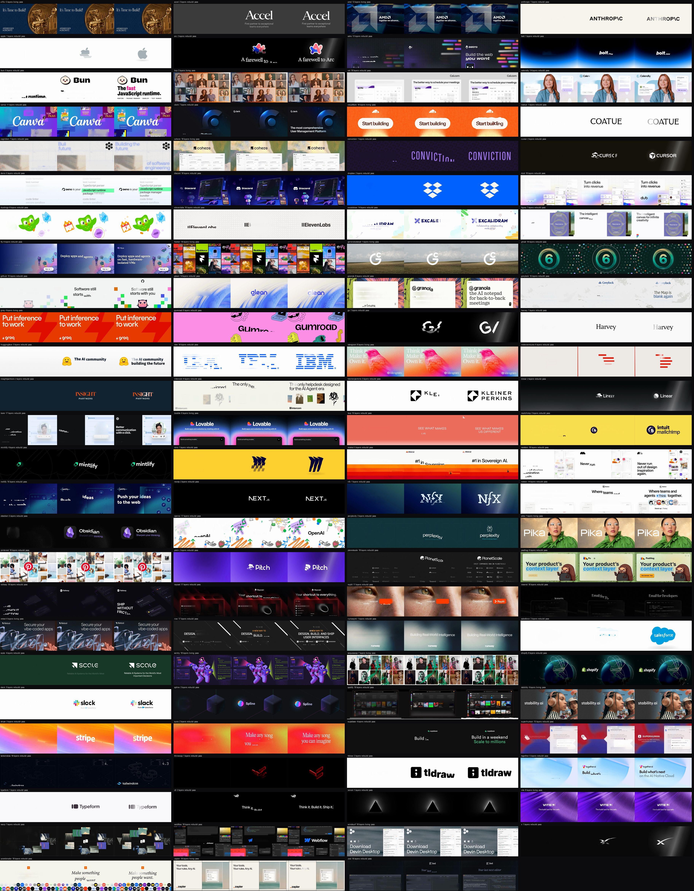

# Eval: 103 real OG images

The skill should work on any approved OG image, not only on cards made for it. This folder is its test: the Open Graph images of 103 well-known sites (developer tools and products, venture capital firms, AI companies and technology companies), each put through the whole route A pipeline with no hand tuning, and scored.



```bash
python3 eval/fetch.py            # download the og:image of every site in sites.txt that is not in cards/ yet
python3 eval/run.py              # all cards, 3 at a time: out/*.mp4, results.json, sheet.jpg, the table below
python3 eval/run.py --only stripe,github --keep   # a few cards, keeping their layers.js, cuts and frames in eval/work/
```

What is measured on every card:

| Check | Pass when |
|---|---|
| Frame 0 | it equals the card: mean difference ≤ 2, and local defects (a gap between letters, a missing edge) on ≤ 0.05 % of pixels |
| Seam | the jump from the last frame to the first is no bigger than an ordinary frame step |
| Size | MP4 ≤ 2 MB, frame-0 JPEG ≤ 180 KB |

`results.json` also records what the engine decided for each card (how many layers, which kinds, rebuild or living), so a change to the engine can be compared card by card. Re-run after any change to `scripts/` or `template/from-image.html` and read the diff of `results.json` and `sheet.jpg`.

The images in `cards/` were fetched from each site's `og:image` by `fetch.py` (`sites.txt` lists the pages, in groups with the date each group was fetched: 2026-10-29 and 2026-10-30) and cover-cropped to 1200×630. Sites with no og:image, a square logo instead of a link card, or a server that refuses the request are skipped. They belong to their owners and are here only as test inputs; they are not covered by this repository's MIT licence.

<!-- results -->
**103 of 103 cards pass.**

| Card | Layers | Kinds | Style | Frame 0 (mean / local) | Seam / step | MP4 | Pass |
|---|---|---|---|---|---|---|---|
| [a16z](out/a16z.mp4) | 5 | text 3, headline 1, icon 1 | living | 0.524 / 0.0% | 0 / 2 | 1273 KB | yes |
| [accel](out/accel.mp4) | 3 | text 2, headline 1 | rebuild | 0.163 / 0.0% | 0 / 3 | 125 KB | yes |
| [amd](out/amd.mp4) | 13 | stroke 4, shape 2, illustration 2, label 2, text 2, icon 1 | living | 0.414 / 0.0% | 0 / 2 | 1046 KB | yes |
| [anthropic](out/anthropic.mp4) | 1 | headline 1 | rebuild | 0.07 / 0.0% | 0 / 2 | 64 KB | yes |
| [apple](out/apple.mp4) | 1 | shape 1 | rebuild | 0.007 / 0.0% | 16 / 16 | 43 KB | yes |
| [arc](out/arc.mp4) | 2 | illustration 1, headline 1 | rebuild | 0.131 / 0.0% | 53 / 52 | 259 KB | yes |
| [astro](out/astro.mp4) | 13 | illustration 8, headline 2, logo 1, text 1, pill 1 | rebuild | 0.397 / 0.0% | 0 / 3 | 734 KB | yes |
| [bolt](out/bolt.mp4) | 1 | headline 1 | rebuild | 0.17 / 0.0% | 0 / 2 | 256 KB | yes |
| [bun](out/bun.mp4) | 5 | headline 3, logo 1, label 1 | rebuild | 0.324 / 0.0% | 0 / 2 | 274 KB | yes |
| [bvp](out/bvp.mp4) | 3 | stroke 1, shape 1, icon 1 | living | 0.433 / 0.0% | 0 / 1 | 1128 KB | yes |
| [cal](out/cal.mp4) | 18 | pill 9, label 4, icon 2, text 1, headline 1, illustration 1 | rebuild | 0.271 / 0.0% | 1 / 1 | 244 KB | yes |
| [calendly](out/calendly.mp4) | 14 | label 5, shape 4, illustration 2, logo 1, headline 1, icon 1 | rebuild | 0.28 / 0.0% | 0 / 3 | 563 KB | yes |
| [canva](out/canva.mp4) | 11 | illustration 5, text 3, icon 2, stroke 1 | rebuild | 0.273 / 0.0% | 0 / 2 | 599 KB | yes |
| [clerk](out/clerk.mp4) | 7 | stroke 3, headline 2, logo 1, text 1 | rebuild | 0.238 / 0.0% | 0 / 1 | 179 KB | yes |
| [cloudflare](out/cloudflare.mp4) | 18 | stroke 15, headline 2, shape 1 | living | 0.364 / 0.0% | 0 / 2 | 1249 KB | yes |
| [coatue](out/coatue.mp4) | 1 | headline 1 | rebuild | 0.088 / 0.0% | 0 / 2 | 72 KB | yes |
| [cognition](out/cognition.mp4) | 7 | illustration 3, stroke 2, panel 1, headline 1 | rebuild | 0.272 / 0.0% | 1 / 1 | 491 KB | yes |
| [cohere](out/cohere.mp4) | 18 | label 10, stroke 4, headline 2, icon 1, illustration 1 | living | 0.402 / 0.0% | 0 / 2 | 1716 KB | yes |
| [conviction](out/conviction.mp4) | 1 | headline 1 | rebuild | 0.195 / 0.0% | 0 / 2 | 229 KB | yes |
| [cursor](out/cursor.mp4) | 2 | logo 1, headline 1 | rebuild | 0.064 / 0.0% | 39 / 38 | 121 KB | yes |
| [deno](out/deno.mp4) | 5 | text 4, headline 1 | rebuild | 0.191 / 0.0% | 0 / 1 | 213 KB | yes |
| [discord](out/discord.mp4) | 18 | icon 15, headline 1, logo 1, illustration 1 | rebuild | 0.273 / 0.0% | 0 / 3 | 636 KB | yes |
| [dropbox](out/dropbox.mp4) | 2 | shape 2 | rebuild | 0.039 / 0.0% | 1 / 1 | 157 KB | yes |
| [dub](out/dub.mp4) | 18 | icon 5, label 4, stroke 3, text 2, shape 1, illustration 1, headline 1, avatar 1 | rebuild | 0.326 / 0.0% | 0 / 1 | 294 KB | yes |
| [duolingo](out/duolingo.mp4) | 8 | shape 5, illustration 1, icon 1, avatar 1 | rebuild | 0.092 / 0.0% | 0 / 1 | 162 KB | yes |
| [elevenlabs](out/elevenlabs.mp4) | 16 | shape 13, logo 1, stroke 1, headline 1 | rebuild | 0.211 / 0.0% | 0 / 1 | 262 KB | yes |
| [excalidraw](out/excalidraw.mp4) | 14 | icon 8, shape 2, logo 1, headline 1, text 1, label 1 | rebuild | 0.174 / 0.0% | 0 / 1 | 277 KB | yes |
| [figma](out/figma.mp4) | 7 | headline 3, icon 2, stroke 1, illustration 1 | rebuild | 0.298 / 0.0% | 1 / 2 | 419 KB | yes |
| [fly](out/fly.mp4) | 9 | icon 4, headline 3, avatar 1, text 1 | rebuild | 0.372 / 0.0% | 0 / 3 | 706 KB | yes |
| [framer](out/framer.mp4) | 18 | headline 6, label 4, shape 3, illustration 2, icon 2, stroke 1 | living | 0.499 / 0.0% | 0 / 3 | 976 KB | yes |
| [generalcatalyst](out/generalcatalyst.mp4) | 1 | shape 1 | living | 0.233 / 0.0% | 0 / 1 | 594 KB | yes |
| [ghost](out/ghost.mp4) | 18 | icon 14, illustration 2, avatar 1, shape 1 | rebuild | 0.24 / 0.0% | 1 / 1 | 412 KB | yes |
| [github](out/github.mp4) | 10 | shape 4, illustration 3, headline 2, icon 1 | rebuild | 0.233 / 0.0% | 0 / 2 | 237 KB | yes |
| [glean](out/glean.mp4) | 14 | shape 6, stroke 2, icon 2, headline 1, illustration 1, label 1, text 1 | rebuild | 0.151 / 0.0% | 0 / 2 | 408 KB | yes |
| [granola](out/granola.mp4) | 8 | icon 4, headline 4 | rebuild | 0.504 / 0.0% | 0 / 2 | 749 KB | yes |
| [greylock](out/greylock.mp4) | 10 | shape 7, headline 3 | rebuild | 0.186 / 0.0% | 1 / 1 | 289 KB | yes |
| [groq](out/groq.mp4) | 4 | headline 4 | living | 0.134 / 0.0% | 0 / 2 | 246 KB | yes |
| [gumroad](out/gumroad.mp4) | 6 | illustration 5, headline 1 | rebuild | 0.413 / 0.0% | 0 / 2 | 652 KB | yes |
| [gv](out/gv.mp4) | 1 | shape 1 | rebuild | 0.049 / 0.0% | 58 / 62 | 345 KB | yes |
| [harvey](out/harvey.mp4) | 1 | headline 1 | rebuild | 0.053 / 0.0% | 0 / 3 | 53 KB | yes |
| [huggingface](out/huggingface.mp4) | 3 | headline 2, illustration 1 | rebuild | 0.165 / 0.0% | 0 / 2 | 206 KB | yes |
| [ibm](out/ibm.mp4) | 18 | pill 18 | rebuild | 0.164 / 0.0% | 0 / 1 | 119 KB | yes |
| [ideogram](out/ideogram.mp4) | 8 | shape 6, headline 2 | living | 0.391 / 0.0% | 0 / 2 | 1278 KB | yes |
| [indexventures](out/indexventures.mp4) | 6 | pill 5, illustration 1 | rebuild | 0.063 / 0.0% | 0 / 1 | 52 KB | yes |
| [insightpartners](out/insightpartners.mp4) | 2 | headline 1, text 1 | rebuild | 0.045 / 0.0% | 0 / 1 | 61 KB | yes |
| [intercom](out/intercom.mp4) | 9 | headline 3, icon 2, panel 1, illustration 1, photo 1, text 1 | rebuild | 0.415 / 0.0% | 30 / 29 | 464 KB | yes |
| [kleinerperkins](out/kleinerperkins.mp4) | 3 | headline 2, panel 1 | rebuild | 0.145 / 0.0% | 0 / 1 | 113 KB | yes |
| [linear](out/linear.mp4) | 2 | logo 1, headline 1 | rebuild | 0.078 / 0.0% | 47 / 47 | 230 KB | yes |
| [loom](out/loom.mp4) | 17 | icon 6, illustration 4, headline 3, stroke 2, shape 1, label 1 | rebuild | 0.265 / 0.0% | 1 / 3 | 404 KB | yes |
| [lovable](out/lovable.mp4) | 6 | text 4, headline 1, avatar 1 | living | 0.315 / 0.0% | 0 / 2 | 738 KB | yes |
| [lsvp](out/lsvp.mp4) | 10 | stroke 7, headline 2, icon 1 | rebuild | 0.07 / 0.0% | 0 / 1 | 79 KB | yes |
| [mailchimp](out/mailchimp.mp4) | 3 | headline 2, logo 1 | rebuild | 0.133 / 0.0% | 0 / 2 | 180 KB | yes |
| [mintlify](out/mintlify.mp4) | 4 | stroke 3, headline 1 | rebuild | 0.077 / 0.0% | 0 / 0 | 75 KB | yes |
| [miro](out/miro.mp4) | 1 | shape 1 | rebuild | 0.048 / 0.0% | 49 / 46 | 246 KB | yes |
| [mistral](out/mistral.mp4) | 5 | logo 1, text 1, headline 1, illustration 1, stroke 1 | rebuild | 0.166 / 0.0% | 0 / 2 | 282 KB | yes |
| [mobbin](out/mobbin.mp4) | 18 | icon 8, headline 4, illustration 2, shape 1, pill 1, avatar 1, label 1 | rebuild | 0.316 / 0.0% | 0 / 2 | 470 KB | yes |
| [netlify](out/netlify.mp4) | 16 | icon 6, avatar 5, headline 3, text 1, shape 1 | rebuild | 0.274 / 0.0% | 1 / 3 | 566 KB | yes |
| [nextjs](out/nextjs.mp4) | 2 | headline 1, text 1 | rebuild | 0.049 / 0.0% | 0 / 2 | 39 KB | yes |
| [nfx](out/nfx.mp4) | 1 | shape 1 | rebuild | 0.084 / 0.0% | 64 / 63 | 642 KB | yes |
| [notion](out/notion.mp4) | 14 | stroke 3, icon 3, text 2, headline 2, shape 2, logo 1, illustration 1 | rebuild | 0.376 / 0.0% | 0 / 1 | 408 KB | yes |
| [obsidian](out/obsidian.mp4) | 5 | illustration 2, stroke 1, headline 1, text 1 | rebuild | 0.159 / 0.0% | 1 / 2 | 232 KB | yes |
| [openai](out/openai.mp4) | 17 | icon 8, shape 4, headline 2, illustration 2, text 1 | rebuild | 0.452 / 0.0% | 0 / 2 | 665 KB | yes |
| [perplexity](out/perplexity.mp4) | 3 | icon 1, headline 1, text 1 | rebuild | 0.119 / 0.0% | 0 / 1 | 123 KB | yes |
| [pika](out/pika.mp4) | 7 | shape 4, icon 1, headline 1, text 1 | living | 0.256 / 0.0% | 0 / 1 | 653 KB | yes |
| [pinterest](out/pinterest.mp4) | 16 | illustration 9, shape 3, icon 3, stroke 1 | rebuild | 0.433 / 0.0% | 1 / 3 | 932 KB | yes |
| [pitch](out/pitch.mp4) | 2 | logo 1, headline 1 | rebuild | 0.07 / 0.0% | 40 / 39 | 338 KB | yes |
| [planetscale](out/planetscale.mp4) | 18 | logo 5, text 4, label 4, shape 3, headline 1, icon 1 | rebuild | 0.374 / 0.0% | 0 / 2 | 318 KB | yes |
| [posthog](out/posthog.mp4) | 9 | icon 3, illustration 2, stroke 1, logo 1, headline 1, pill 1 | rebuild | 0.322 / 0.0% | 1 / 2 | 599 KB | yes |
| [railway](out/railway.mp4) | 18 | icon 7, illustration 4, headline 3, logo 1, text 1, label 1, stroke 1 | rebuild | 0.239 / 0.0% | 1 / 2 | 370 KB | yes |
| [raycast](out/raycast.mp4) | 17 | icon 8, label 5, logo 1, text 1, headline 1, illustration 1 | rebuild | 0.284 / 0.0% | 0 / 1 | 277 KB | yes |
| [replit](out/replit.mp4) | 11 | shape 3, icon 3, illustration 2, headline 2, label 1 | rebuild | 0.236 / 0.0% | 1 / 1 | 513 KB | yes |
| [resend](out/resend.mp4) | 18 | shape 4, label 4, stroke 3, illustration 3, icon 2, headline 1, pill 1 | rebuild | 0.197 / 0.0% | 0 / 2 | 279 KB | yes |
| [retool](out/retool.mp4) | 6 | text 2, headline 2, label 1, shape 1 | living | 0.378 / 0.0% | 0 / 2 | 694 KB | yes |
| [rive](out/rive.mp4) | 17 | stroke 7, text 2, headline 2, logo 2, label 2, icon 1, illustration 1 | rebuild | 0.323 / 0.0% | 0 / 1 | 215 KB | yes |
| [runwayml](out/runwayml.mp4) | 1 | headline 1 | rebuild | 0.148 / 0.0% | 0 / 2 | 319 KB | yes |
| [salesforce](out/salesforce.mp4) | 2 | headline 1, shape 1 | rebuild | 0.048 / 0.0% | 44 / 43 | 269 KB | yes |
| [scale](out/scale.mp4) | 4 | text 2, logo 1, headline 1 | rebuild | 0.178 / 0.0% | 0 / 1 | 129 KB | yes |
| [sentry](out/sentry.mp4) | 18 | label 5, stroke 4, illustration 3, text 2, pill 2, shape 1, icon 1 | living | 0.259 / 0.0% | 1 / 2 | 519 KB | yes |
| [sequoiacap](out/sequoiacap.mp4) | 7 | stroke 2, shape 2, illustration 1, panel 1, headline 1 | living | 0.641 / 0.0% | 0 / 2 | 1593 KB | yes |
| [shopify](out/shopify.mp4) | 8 | icon 5, headline 1, stroke 1, shape 1 | rebuild | 0.275 / 0.0% | 0 / 2 | 235 KB | yes |
| [slack](out/slack.mp4) | 3 | logo 1, headline 1, text 1 | rebuild | 0.084 / 0.0% | 0 / 1 | 87 KB | yes |
| [spline](out/spline.mp4) | 3 | illustration 1, label 1, stroke 1 | rebuild | 0.07 / 0.0% | 0 / 1 | 99 KB | yes |
| [spotify](out/spotify.mp4) | 18 | icon 6, illustration 5, photo 3, label 2, stroke 1, shape 1 | rebuild | 0.398 / 0.0% | 27 / 26 | 852 KB | yes |
| [stability](out/stability.mp4) | 4 | shape 1, pill 1, headline 1, icon 1 | living | 0.414 / 0.0% | 0 / 2 | 1027 KB | yes |
| [stripe](out/stripe.mp4) | 3 | shape 2, headline 1 | rebuild | 0.24 / 0.0% | 0 / 1 | 549 KB | yes |
| [suno](out/suno.mp4) | 2 | headline 2 | rebuild | 0.402 / 0.0% | 0 / 2 | 964 KB | yes |
| [supabase](out/supabase.mp4) | 4 | headline 2, logo 1, text 1 | rebuild | 0.142 / 0.0% | 0 / 1 | 134 KB | yes |
| [superhuman](out/superhuman.mp4) | 10 | logo 2, illustration 2, icon 2, label 2, avatar 1, text 1 | rebuild | 0.378 / 0.0% | 0 / 1 | 860 KB | yes |
| [tailwindcss](out/tailwindcss.mp4) | 18 | icon 8, shape 3, label 2, headline 2, illustration 2, logo 1 | rebuild | 0.267 / 0.0% | 1 / 1 | 453 KB | yes |
| [thrivecap](out/thrivecap.mp4) | 1 | stroke 1 | rebuild | 0.026 / 0.0% | 37 / 35 | 71 KB | yes |
| [tldraw](out/tldraw.mp4) | 2 | panel 1, headline 1 | rebuild | 0.109 / 0.0% | 0 / 1 | 104 KB | yes |
| [together](out/together.mp4) | 5 | shape 2, headline 2, illustration 1 | rebuild | 0.151 / 0.0% | 0 / 1 | 217 KB | yes |
| [typeform](out/typeform.mp4) | 1 | headline 1 | rebuild | 0.052 / 0.0% | 0 / 2 | 54 KB | yes |
| [v0](out/v0.mp4) | 2 | headline 2 | rebuild | 0.116 / 0.0% | 0 / 2 | 67 KB | yes |
| [vercel](out/vercel.mp4) | 1 | illustration 1 | rebuild | 0.046 / 0.0% | 1 / 1 | 83 KB | yes |
| [vite](out/vite.mp4) | 8 | headline 3, illustration 2, label 1, logo 1, stroke 1 | living | 0.528 / 0.0% | 0 / 2 | 1229 KB | yes |
| [warp](out/warp.mp4) | 7 | icon 3, shape 2, illustration 1, panel 1 | rebuild | 0.22 / 0.0% | 0 / 1 | 268 KB | yes |
| [webflow](out/webflow.mp4) | 18 | illustration 6, icon 4, label 4, stroke 2, logo 1, headline 1 | rebuild | 0.354 / 0.0% | 1 / 3 | 844 KB | yes |
| [windsurf](out/windsurf.mp4) | 18 | label 8, text 5, headline 5 | living | 0.475 / 0.0% | 0 / 2 | 1555 KB | yes |
| [x](out/x.mp4) | 1 | shape 1 | rebuild | 0.027 / 0.0% | 52 / 53 | 205 KB | yes |
| [ycombinator](out/ycombinator.mp4) | 18 | avatar 15, headline 2, illustration 1 | rebuild | 0.354 / 0.0% | 0 / 2 | 415 KB | yes |
| [zapier](out/zapier.mp4) | 18 | label 8, headline 5, icon 2, illustration 1, logo 1, text 1 | living | 0.323 / 0.0% | 0 / 3 | 350 KB | yes |
| [zed](out/zed.mp4) | 18 | label 8, illustration 6, logo 1, text 1, headline 1, stroke 1 | rebuild | 0.38 / 0.0% | 0 / 2 | 796 KB | yes |
<!-- /results -->
